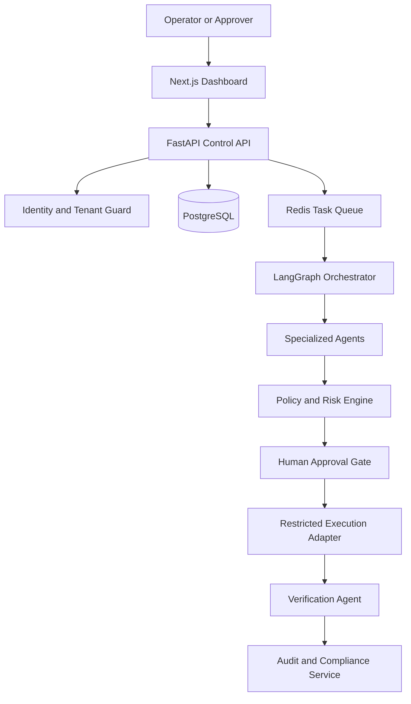

# AgentShield Ops — System Architecture

## 1. Architecture Objective

AgentShield Ops is a multi-tenant SaaS platform that coordinates autonomous incident-response agents while keeping authorization, policy evaluation and execution controls deterministic.

The language model may investigate evidence and recommend actions, but it cannot directly bypass policies or execute unrestricted infrastructure commands.

## 2. High-Level Architecture



## 3. Architectural Principle

AgentShield uses a split-control architecture.

### Probabilistic components

AI agents may:

- Summarize evidence
- Classify incidents
- Generate root-cause hypotheses
- Recommend recovery actions
- Explain risks
- Produce structured reports

Their output is probabilistic and must be validated.

### Deterministic components

Traditional application code controls:

- Authentication
- Authorization
- Tenant isolation
- Schema validation
- Policy enforcement
- Risk thresholds
- Human approval
- Execution permissions
- Rate limits
- Idempotency
- Audit records

An LLM recommendation is treated as untrusted input until deterministic controls approve it.

## 4. Core Components

### 4.1 Web Dashboard

Technology:

- Next.js
- TypeScript
- Tailwind CSS

Responsibilities:

- User authentication screens
- Organization onboarding
- Incident list and details
- Evidence visualization
- Approval inbox
- Agent-workflow timeline
- Audit and compliance views
- Usage and plan information

Why Next.js:

- Supports production React applications
- Provides routing and server-side capabilities
- Works well with TypeScript
- Has a strong deployment ecosystem
- Allows rapid dashboard development

Why not plain React with Vite:

Vite is simpler for a client-only application, but Next.js gives us routing, layouts, server-side rendering options and a clearer path toward a commercial SaaS product.

### 4.2 Control API

Technology:

- Python
- FastAPI
- Pydantic

Responsibilities:

- Validate incoming requests
- Authenticate users and API keys
- Resolve tenant identity
- Enforce role permissions
- Expose incident and approval endpoints
- Create background jobs
- Return structured errors
- Record security-relevant events

Why FastAPI:

- Native Python support for AI services
- Automatic OpenAPI documentation
- Strong request validation with Pydantic
- Asynchronous endpoint support
- Fast development for a one-month MVP

Why not Django initially:

Django includes a larger built-in ecosystem, but FastAPI provides a smaller API-focused foundation and integrates naturally with Python agent services. Django may be reconsidered if the product later needs a large administrative system.

### 4.3 PostgreSQL Database

Responsibilities:

- Organizations and users
- Roles and permissions
- Incidents and evidence references
- Agent runs and structured results
- Proposed actions
- Approval records
- Execution records
- Verification results
- Policies and risk decisions
- Usage events
- Audit events

Why PostgreSQL:

- Reliable relational transactions
- Strong constraints
- JSONB support for controlled flexible data
- Row-Level Security support
- Widely used in enterprise SaaS systems

Why not MongoDB:

Most AgentShield records have strong relationships and transaction requirements. PostgreSQL provides better integrity for approvals, execution state and tenant ownership while still supporting JSONB where flexibility is needed.

### 4.4 Redis

Responsibilities:

- Background-job queue
- Short-lived workflow state
- Rate-limit counters
- Idempotency locks
- Temporary caches

Redis must not be treated as the permanent source of truth. Durable business records remain in PostgreSQL.

### 4.5 Agent Orchestrator

Technology:

- LangGraph
- Python workers

Responsibilities:

- Coordinate the agent sequence
- Store resumable workflow state
- Pause at approval gates
- Resume approved workflows
- Handle retries and failures
- Prevent completed steps from repeating

Why LangGraph:

Incident response is a stateful workflow rather than a single chatbot request. LangGraph supports explicit nodes, transitions, checkpoints and human-in-the-loop pauses.

Why not a simple agent loop:

A free-running loop is harder to test, audit and safely resume. A graph makes allowed transitions visible and limits uncontrolled behaviour.

## 5. Initial Agents

### Incident Detection Agent

Normalizes alerts and classifies severity, affected service and incident type.

### Intent Integrity Agent

Checks evidence and instructions for prompt injection, secret patterns, unexpected tools and mismatched targets.

### Root Cause Analysis Agent

Correlates alerts, logs, metrics and deployment history into ranked hypotheses with supporting evidence.

### Simulation Agent

Creates a safe dry-run result showing expected impact, affected resources and warnings.

### Recovery Agent

Executes only an approved action through a restricted adapter.

### Verification Agent

Compares system health before and after execution and determines whether recovery succeeded.

### Compliance Agent

Maps identity, policy, approval, execution and verification records into an exportable evidence package.

## 6. Model Provider Strategy

AgentShield will use a model-provider interface rather than calling one provider directly throughout the codebase.

```text
Agent Workflow
      |
ModelProvider Interface
      |
Mock / Provider A / Provider B / Local Model
```

The interface will accept:

- System instruction
- Validated incident context
- Allowed tool definitions
- Required structured-output schema
- Timeout and token limits

It will return:

- Structured result
- Model identifier
- Token usage
- Latency
- Validation status
- Error information

### Initial development model

The first workflows will use deterministic mock responses.

Why:

- No API cost during early development
- Repeatable automated tests
- No dependency on API keys
- Easier failure simulation
- Architecture can be validated before model integration

A real model will later be selected using:

- Structured JSON reliability
- Tool-calling accuracy
- Reasoning quality
- Latency
- Cost
- Context-window requirements
- Data-retention policy
- Regional availability

No security decision may depend solely on the selected model.

## 7. Authentication and Authorization

### Authentication

The system will initially support:

- Email and password authentication
- Password hashing
- Short-lived access tokens
- Refresh-token rotation
- Scoped API keys

### Authorization

Initial roles:

- Organization Administrator
- Security Administrator
- Operator
- Approver
- Auditor
- Viewer

Every protected request must include:

- Authenticated actor
- Tenant identifier
- Required permission
- Target resource
- Correlation identifier

Backend authorization is mandatory. Hiding a button in the frontend is not a security control.

## 8. Tenant Isolation

Every tenant-owned database record must contain an `organization_id`.

Isolation will be enforced through:

1. Tenant identity derived from trusted authentication
2. Tenant-aware repository queries
3. PostgreSQL Row-Level Security
4. Tenant identity included in queued jobs
5. Tenant-scoped storage paths
6. Cross-tenant authorization tests
7. Tenant-scoped audit exports

The API must never trust an `organization_id` supplied only by the browser.

## 9. Policy and Risk Engine

Inputs:

- Tenant
- Actor and role
- Incident severity
- Proposed action
- Target resource
- Evidence confidence
- Environment
- Simulation result
- Time restrictions

Possible decisions:

- `ALLOW`
- `DENY`
- `REQUIRE_APPROVAL`

Each decision must include:

- Policy identifier
- Policy version
- Risk score
- Explanation
- Decision timestamp

The MVP may begin with deterministic Python rules behind a policy interface. Open Policy Agent can then be integrated without changing the rest of the system.

## 10. Human Approval

A high-risk action cannot execute until an authorized approver accepts the exact action payload.

An approval contains:

- Action hash
- Target resource
- Risk score
- Policy decision
- Simulation result
- Approver identity
- Expiration time
- One-time execution token

Changing the action after approval invalidates the approval.

## 11. Restricted Execution

Agents never receive unrestricted shell or cloud access.

Execution adapters will:

- Expose allowlisted operations
- Validate parameters
- Enforce tenant and environment scope
- Require a valid execution token
- Apply timeouts
- Use idempotency keys
- Record exact inputs and outputs
- Support an emergency kill switch

Month-one execution will use mock adapters or a local Kubernetes environment rather than real customer production systems.

## 12. Audit Architecture

Security-relevant events include:

- Login attempts
- API-key usage
- Incident creation
- Agent execution
- Evidence access
- Policy decisions
- Approval or rejection
- Recovery execution
- Verification result
- Audit export

Each event contains:

- Event ID
- Timestamp
- Tenant ID
- Actor
- Agent or service
- Action
- Resource
- Correlation ID
- Previous-event hash
- Current-event hash

Hash chaining helps reveal unauthorized modification. It does not replace secure database permissions, backups or external log retention.

## 13. Initial Deployment

Local development:

- Next.js application
- FastAPI application
- Python agent worker
- PostgreSQL
- Redis
- Policy service
- Mock execution service
- Docker Compose

Hosted beta:

- Containerized web, API and worker services
- Managed PostgreSQL
- Managed Redis
- Encrypted environment secrets
- HTTPS
- Health and readiness checks
- Centralized application logs
- Automated deployment pipeline

## 14. Repository Boundaries

```text
agentshield-ops/
├── apps/
│   ├── web/
│   └── api/
├── services/
│   ├── orchestrator/
│   ├── policy-engine/
│   └── agent-worker/
├── packages/
│   ├── shared-types/
│   └── python-sdk/
├── infrastructure/
├── tests/
├── docs/
├── .env.example
├── docker-compose.yml
└── README.md
```

## 15. Architecture Rules

1. Frontend code never directly accesses the database.
2. The browser never supplies trusted tenant identity.
3. LLM output is always schema-validated.
4. Agents cannot bypass the policy engine.
5. High-risk actions require human approval.
6. Approved action payloads cannot be changed.
7. Execution tools are allowlisted and parameter-validated.
8. Durable workflow state is recorded.
9. Every security-sensitive operation is auditable.
10. Secrets are never placed in prompts, logs or source control.