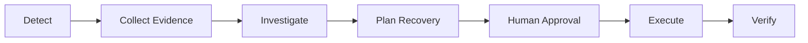

# AgentShield Ops — Product Charter

| | |
|---|---|
| **Version** | 0.1 |
| **Status** | Draft — pending team review |
| **Owner** | Meghanshu Kumar |
| **Team** | Meghanshu Kumar, Karthik |

## Table of Contents

1. [Product Vision](#1-product-vision)
2. [Problem Statement](#2-problem-statement)
3. [Target Users](#3-target-users)
4. [Demo Scenarios](#4-demo-scenarios)
5. [Week 1 Plan](#5-week-1-plan)
6. [Success Criteria](#6-success-criteria)
7. [Technical Direction](#7-technical-direction)
8. [Security and Safety Principles](#8-security-and-safety-principles)
9. [MVP Boundaries](#9-mvp-boundaries)
10. [Team Responsibilities](#10-team-responsibilities)
11. [Definition of Done](#11-definition-of-done)
12. [Open Decisions](#12-open-decisions)
13. [Day 1 Checklist](#13-day-1-checklist)

---

## 1. Product Vision

**AgentShield Ops** is an AI-powered incident operations platform. It helps engineering teams **detect, investigate, and respond** to application incidents safely.

It reduces manual effort by coordinating the full incident lifecycle through controlled workflows:

> **Key principle:** Security policies and authorization are enforced by the backend and security control plane — **never delegated to the AI model**.

---

## 2. Problem Statement

Today, engineers handle application failures and suspicious traffic by hand. They must:

1. Collect logs and metrics
2. Identify possible causes
3. Recommend fixes
4. Get approvals
5. Run recovery steps
6. Check whether the problem is actually resolved

This is slow and hard to coordinate.

**AgentShield Ops** provides one central platform that combines AI-assisted investigation and workflow automation with **security controls, human oversight, and auditability**.

---

## 3. Target Users

| Role | What they do |
|---|---|
| **Operations Engineer** | Monitors incidents, reviews evidence, investigates failures, tracks recovery |
| **Security Engineer** | Investigates suspicious activity, reviews proposed response actions |
| **Approver** | Reviews and authorizes actions that need human approval |
| **Organization Admin** | Manages organization access and security settings |

---

## 4. Demo Scenarios

> The investigation, simulation, approval, execution, and verification steps below describe the **intended product workflow**. Only the ingestion-to-dashboard part is in Week 1 scope.

### Scenario A: Unhealthy Kubernetes Service

**Problem:** A service becomes unhealthy because of repeated container crashes or failed health checks.

| Field | Value |
|---|---|
| Service | `payments-api` |
| Environment | Development Kubernetes cluster |
| Incident type | `service_unhealthy` |
| Severity | High |
| Initial status | Open |

**Workflow**

| # | Step |
|---|---|
| 1 | Receive a simulated alert about the unhealthy service |
| 2 | Validate and normalize the alert into the shared incident schema |
| 3 | Create and store the incident |
| 4 | Investigate logs, metrics, and service information |
| 5 | Generate an evidence-backed diagnosis |
| 6 | Propose a recovery action |
| 7 | Simulate the action and assess its impact |
| 8 | Apply security policies and get approval if required |
| 9 | Execute the authorized action |
| 10 | Verify recovery and record the outcome |

**Week 1 scope:** Generate a simulated alert → validate it → store the incident → show it in the operations dashboard.

### Scenario B: Suspicious Traffic / IP Incident

**Problem:** An application receives unusual or possibly malicious traffic that needs investigation.

| Field | Value |
|---|---|
| Incident type | `suspicious_traffic` |
| Source | Mock security alert generator |
| Severity | Medium |
| Initial status | Open |

**Workflow**

| # | Step |
|---|---|
| 1 | Receive a simulated suspicious-traffic alert |
| 2 | Validate and normalize the event |
| 3 | Create and store the incident |
| 4 | Investigate request patterns and available evidence |
| 5 | Assess whether the activity is suspicious |
| 6 | Propose a response (e.g., investigate further or block a source IP) |
| 7 | Simulate the response |
| 8 | Enforce security policies and approval requirements |
| 9 | Execute the authorized response |
| 10 | Verify the outcome and record the decision |

**Week 1 scope:** Generate a simulated suspicious-traffic event and process it through the **same** ingestion and dashboard flow as Scenario A.

---

## 5. Week 1 Plan

**Goal:** Build a working, authenticated path from **incident generation** to **incident visibility**.

| Day | Focus | Key deliverables |
|---|---|---|
| **1** | Problem definition and charter | Define the problem; document both scenarios and operator journeys; set MVP scope and success criteria; agree responsibilities with Karthik |
| **2** | Architecture and repo foundation | Set up repo structure and dev workflow; define boundaries between frontend, agent worker, backend, database, and infrastructure; document architecture; ensure components run locally |
| **3** | Data model and API contracts | Define incident and evidence models; set the shared incident-event schema; agree API request/response formats; prepare migrations and integration contracts |
| **4** | Authentication and onboarding | Build signup, login, and organization onboarding screens; integrate with auth APIs; verify the backend enforces access to protected resources |
| **5** | Detection and ingestion | Build a mock alert generator; normalize events into the shared schema; integrate with the authenticated ingestion API; verify validation, persistence, and duplicate handling |
| **6** | Operations dashboard | Build app shell and incident list; add incident details and filters; implement loading, empty, and error states; show data from real backend APIs |
| **7** | Integration and release | Add frontend component and integration tests; Dockerize the frontend and agent worker; run the full login-to-incident demo; update setup docs and risk register; review and prepare the `v0.1` tag |

---

## 6. Success Criteria

> Proposed — to be agreed by the team.

By the end of Week 1:

- [ ] **1. Clean setup:** The app starts from a clean environment using the documented instructions.
- [ ] **2. Auth:** A user can sign up, log in, and reach the correct organization workspace.
- [ ] **3. Scenarios:** Both demo scenarios generate valid simulated incident events.
- [ ] **4. Validation:** The ingestion API validates events against the agreed schema.
- [ ] **5. Idempotency:** Repeating a request with the same valid idempotency key does not create a duplicate incident.
- [ ] **6. Persistence:** Valid incidents are saved in the database.
- [ ] **7. Visibility:** An authenticated user can view their own organization's incidents.
- [ ] **8. Tenant isolation:** The backend rejects cross-tenant incident access.
- [ ] **9. Real data:** The dashboard uses real APIs, not hardcoded incident records.
- [ ] **10. Reproducible:** Automated tests pass and the full demo can be reproduced from the README.

---

## 7. Technical Direction

| Component | Role |
|---|---|
| **LangGraph** | Main workflow engine for stateful incident processing: explicit steps, conditional transitions, retries, checkpointing, and human-approval pauses |
| **LangChain** | Supporting LLM pieces: model abstractions, prompts, tool integrations |
| **Backend API** | Authenticated endpoints for onboarding, incident ingestion, listing, and details *(framework to be agreed)* |
| **PostgreSQL** | Stores incidents and related operational data |
| **Frontend** | Dashboard for onboarding, incident visibility, and future workflows *(framework to follow agreed architecture)* |
| **Docker** | Packages components for reproducible development and demos |
| **Model provider** | To be selected based on cost, reliability, security, and integration needs |
| **MCP (Model Context Protocol)** | *Later:* standardized access to external tools (e.g., monitoring). **Not required** for Week 1 |

> **Architecture principle:**
> LangGraph **coordinates** the workflow → LangChain **supplies** LLM components → deterministic backend controls **enforce** identity, permissions, tenant isolation, and action authorization.

---

## 8. Security and Safety Principles

1. **Trusted auth:** Authentication and authorization are enforced by trusted application services.
2. **Backend tenant isolation:** Enforced on every relevant data-access path.
3. **No AI auto-authorization:** An LLM recommendation must never automatically authorize or execute a sensitive operation.
4. **Proposed ≠ executed:** Proposed actions must be clearly distinguished from actions that actually ran.
5. **Human approval:** Risky actions follow the applicable policy and approval requirements.
6. **Sandbox first:** Use simulated environments before connecting to real infrastructure.
7. **Auditability:** Record operational decisions and execution outcomes.
8. **No secrets in Git:** Secrets and credentials are never committed to the repository.

---

## 9. MVP Boundaries

### Month-One MVP — In Scope

- Organization-aware authentication and incident visibility
- Two repeatable simulated incident scenarios
- Incident validation, ingestion, and persistence
- AI-assisted investigation and workflow orchestration
- Recovery-action proposals and simulation
- Policy-controlled approval and recovery workflows
- Post-action verification and audit evidence
- Dashboard, observability, SDK, documentation, and a demonstrable deployment (per the execution docket)

### Week 1 — Out of Scope

- Fully autonomous production recovery
- Unrestricted access to Kubernetes or production infrastructure
- Real network blocking or other disruptive security actions
- Complex multi-agent collaboration without a defined requirement
- Mandatory MCP integration before the core incident flow works

> Any additional scope must not displace the agreed core workflows.

---

## 10. Team Responsibilities

| | **Meghanshu Kumar** Autonomous Operations & Platform Experience | **Karthik** Security & Governance Control Plane |
|---|---|---|
| **Focus** | Agent workflows, incident intelligence, simulation, recovery workflows | Identity and authentication, tenant isolation, security gateway |
| **Also owns** | Verification and workflow observability | Policy enforcement and risk controls |
| | Dashboard and frontend integration | Approval workflows and compliance |
| | SDK, documentation, deployment (per docket) | Audit and billing controls |

**Shared responsibilities**

- Agreeing on API contracts and event schemas
- Integration and end-to-end testing
- Reviewing pull requests
- Deployment validation and release readiness
- Customer validation and the final demonstration

---

## 11. Definition of Done

A feature is **done** when:

- [ ] Behavior matches the agreed requirements
- [ ] Relevant automated tests pass
- [ ] API contracts and integration behavior are verified
- [ ] Authorization and tenant boundaries are tested where applicable
- [ ] Errors and key operational events are observable
- [ ] Documentation is updated
- [ ] It can be reproduced and demonstrated in the agreed environment
- [ ] Changes are reviewed and merged following the team's Git workflow

---

## 12. Open Decisions

To be confirmed with the team:

| # | Decision |
|---|---|
| 1 | Final backend and frontend frameworks |
| 2 | Database schema and migration strategy |
| 3 | Authentication and tenant-identification contracts |
| 4 | Incident API request and response formats |
| 5 | Required Week 1 test coverage |
| 6 | Local development and Docker Compose setup |
| 7 | Initial LLM provider and later infrastructure integrations |

---

## 13. Day 1 Checklist

- [ ] Product vision and problem statement documented
- [ ] Both demo scenarios defined
- [ ] Operator journeys documented
- [ ] Week 1 scope and month-one boundaries identified
- [ ] Success criteria reviewed with Karthik
- [ ] Technical direction and team responsibilities reviewed
- [ ] Charter committed or submitted for review

**Next milestone:** Day 2 — complete the architecture and repository foundation, using this charter as the reference for implementation decisions.